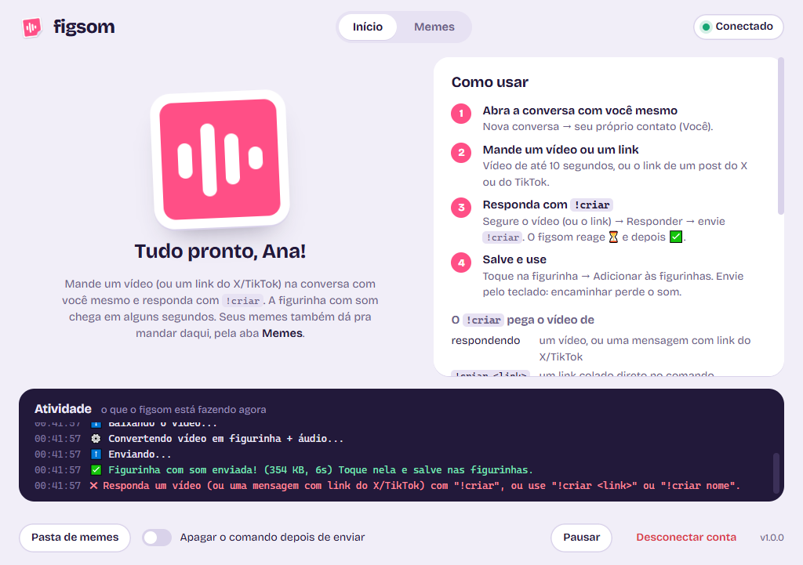
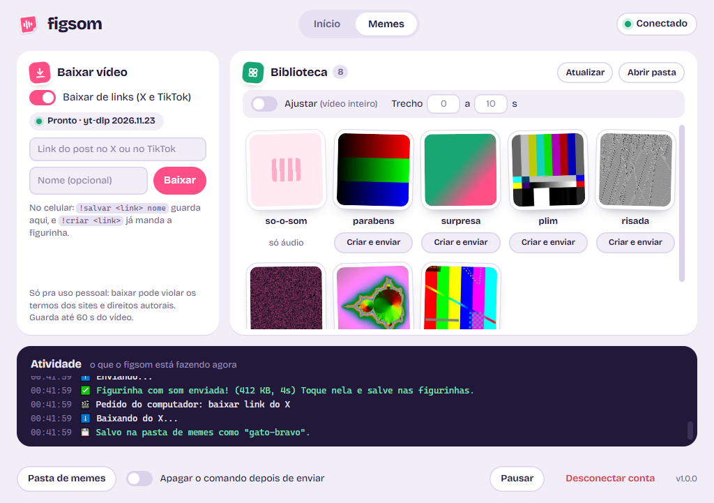

<p align="center">
  
</p>

<h1 align="center">figsom</h1>

<p align="center">Crie <strong>figurinhas com som</strong> no WhatsApp a partir de qualquer vídeo, mesmo que o recurso oficial ainda não tenha chegado pra sua conta.</p>

<p align="center">
  <a href="https://github.com/winipassaia/figsom/releases/latest"><strong>Baixar pra Windows e Linux</strong></a>
  &nbsp;·&nbsp;
  <a href="docs/TUTORIAL.md">Tutorial</a>
  &nbsp;·&nbsp;
  <a href="docs/FORMATO.md">Como funciona</a>
</p>

<p align="center">
  
</p>

Mande um vídeo na conversa com você mesmo, responda com `!criar`, e a figurinha volta com o áudio do próprio vídeo. Depois é só salvar e usar pelo teclado de figurinhas. Também dá pra criar direto de um link do **X** ou do **TikTok**, e mandar os memes da sua pasta pelo computador.

> [!WARNING]
> **Projeto não oficial, use por sua conta e risco.**
> O figsom se conecta ao WhatsApp como um aparelho vinculado usando o [Baileys](https://github.com/WhiskeySockets/Baileys), um cliente **não oficial**, o que vai contra os Termos de Serviço do WhatsApp.
> **O risco de banimento é baixo:** o figsom só age na sua própria conta, na conversa com você mesmo, e nunca manda mensagem pra outras pessoas, que é o que costuma levar a ban. Mas não é zero, então use um número secundário se puder.
> O formato da figurinha com som foi descoberto por engenharia reversa. Se a sua conta ainda não tem o recurso, você vai enviar algo que o WhatsApp ainda não liberou pra ela.
> Não use pra spam nem pra enviar em massa.
> Este projeto não tem nenhuma ligação com o WhatsApp ou a Meta.

---

## Baixar

Na página de **[Releases](https://github.com/winipassaia/figsom/releases/latest)**:

| Sistema | Arquivo |
|---|---|
| **Windows** | `figsom-…-instalador-windows.exe` (ou o `…-portatil-windows.exe`, que não instala) |
| **Ubuntu / Debian** | `figsom-…-linux.deb` |
| **Outras distros Linux** | `figsom-…-linux.AppImage` |

Já vem tudo dentro: não precisa instalar Node.js nem ffmpeg. As somas SHA-256 de cada arquivo ficam no `SHA256SUMS.txt` da release. Na primeira vez, o Windows mostra "O Windows protegeu o computador" porque o app não tem assinatura digital. Clique em **Mais informações → Executar assim mesmo**.

**Primeira vez?** Siga o **[tutorial passo a passo](docs/TUTORIAL.md)**.

## Como funciona

1. O figsom conecta no seu WhatsApp como um aparelho vinculado, igual ao WhatsApp Web, pelo QR code.
2. Na conversa com você mesmo (**"Você"**), você manda um vídeo e responde com `!criar`.
3. O figsom converte o vídeo em **WebP animado 512×512** e o áudio em **OGG/Opus** (até 10 s). Toda figurinha leva nos dados "Criado pelo APP figsom" e, embaixo, "github @winipassaia", que aparecem quando alguém toca nela no WhatsApp.
4. Ele envia a figurinha com som nessa mesma conversa e reage ao seu comando: ⏳ enquanto trabalha, ✅ quando termina (ou ❌ se der erro; o motivo aparece na Atividade).
5. Você toca nela, **salva nas figurinhas** e manda pra quem quiser pelo teclado.

> [!NOTE]
> **Encaminhar a figurinha perde o áudio.** Use sempre a figurinha salva, pelo teclado.

O figsom só aceita comandos na conversa "Você", não guarda mensagens de ninguém e não baixa histórico. A pasta da sessão guarda só o que o protocolo do WhatsApp exige pra funcionar (chaves de criptografia e identificadores de contatos), como qualquer aparelho vinculado.

Um comando mandado com o figsom fechado é atendido quando ele abrir de novo.

## Como achar a conversa "Você"

É a conversa do WhatsApp com o seu próprio número. Todo comando do figsom vai nela.

- **Android e iPhone:** toque em **Nova conversa**. O primeiro contato da lista é você, com **"(Você)"** do lado do nome ou **"Mensagem para você"** embaixo.
- **WhatsApp Web ou Desktop:** clique em **Nova conversa** (o ícone de lápis ou de balão, em cima da lista de conversas) e escolha o seu contato, que aparece no topo como **"(Você)"**.
- **Não apareceu?** Procure pelo seu próprio nome na busca de conversas. Se mesmo assim não achar, abra `wa.me/<seu número>` no navegador do celular, com o código do país e o DDD, só números (ex.: `wa.me/5511999998888`). Ele abre a conversa com você mesmo.
- **Dica:** fixe essa conversa (segure em cima dela → **Fixar**) pra ela ficar sempre no topo.

## Comandos

Todos na conversa **"Você"**:

O **`!criar`** é um comando só, e pega o vídeo de onde fizer sentido:

| Comando | De onde vem o vídeo |
|---|---|
| `!criar` respondendo um vídeo | do vídeo respondido |
| `!criar` respondendo uma mensagem com link | do post do X ou do TikTok desse link ([precisa ligar](#baixar-do-x-e-do-tiktok)) |
| `!criar <link>` | do link colado no próprio comando (mesma coisa) |
| `!criar nome` | de um meme da pasta de memes |

Os outros comandos:

| Comando | O que faz |
|---|---|
| `!salvar <link> [nome]` | Baixa o vídeo pra pasta de memes e responde com o nome salvo e como usar |
| `!memes` | Lista os memes da pasta |
| `!ajuda` | Responde com a lista de comandos |

O `!som` da versão 1.0 continua funcionando: `!som` é o mesmo que `!criar`, e `!som lista` é o mesmo que `!memes`.

A mensagem do comando fica na conversa, com a reação ⏳ → ✅ ou ❌. Quem preferir que ela suma pode ligar **Apagar o comando depois de enviar**, no rodapé do app (no modo terminal, `apagarPedido: true` no `index.js`).

**Opções** (combináveis, em qualquer ordem, em todo `!criar`):

| Opção | Efeito |
|---|---|
| *(nenhuma)* | Figurinha quadrada cortando o **centro** do vídeo |
| `ajustar` | Vídeo **inteiro** no quadrado, com bordas transparentes (`inteiro` também vale) |
| `2-6` | Usa só do segundo 2 ao 6 (aceita `1,5-4`). Máximo de 10 s. |

No `!salvar`, o trecho escolhe que parte do vídeo guardar (até 60 s). Sem trecho, ele guarda os primeiros 60 s.

Exemplos: `!criar 2-6`, `!criar ajustar`, `!criar tome 3-7 ajustar`, `!criar https://x.com/fulano/status/123 0-5`, `!salvar https://www.tiktok.com/@fulano/video/123 danca`.

O link é reconhecido sozinho, com ou sem o `https://`. Se você escrever `x` ou `tiktok` antes dele (`!criar tiktok <link>`), o figsom ignora essa palavra.

**Pasta de memes:** no app, use o botão *Pasta de memes* do rodapé ou o *Abrir pasta* da aba **Memes** (`Documentos/figsom/memes`). Para `!criar nome`, o figsom procura `nome.webp` ou um vídeo (`nome.mp4`, `.mov`, `.webm`, `.mkv`, `.gif`, `.avi`), e um áudio separado (`nome.mp3`, `.ogg`, `.opus`, `.m4a`, `.wav`, `.aac`, `.flac`). O áudio separado é opcional pra vídeos com som, mas obrigatório pra `.gif` e `.webp`, que não têm áudio. Use só o nome do arquivo, sem pastas.

Limites: vídeos de até 100 MB, e no máximo 10 s viram figurinha.

> [!TIP]
> **Figurinha parada (sem animar)?** O WhatsApp só anima figurinhas de até ~1 MB. O figsom reduz a qualidade pra caber, mas um vídeo com muito movimento ou detalhe pode passar disso mesmo assim. O tamanho aparece na mensagem de envio, por exemplo "(354 KB, 6s)". Se passar de ~1000 KB, use um trecho menor, como `!criar 0-5`. As figurinhas oficiais costumam ter de 3 a 5 s.

## Aba Memes (no computador)

<p align="center">
  
</p>

- **Baixar vídeo:** cole o link de um post do X ou do TikTok, dê um nome (opcional) e o vídeo vai pra pasta de memes. É o mesmo que o `!salvar`.
- **Biblioteca:** os memes da pasta, com miniatura. **Criar e enviar** faz a figurinha e manda pra sua conversa "Você", usando as opções de cima (**Ajustar** e **Trecho**). Precisa estar conectado.

## Baixar do X e do TikTok

O `!criar <link>`, o `!salvar` e o *Baixar vídeo* usam o **[yt-dlp](https://github.com/yt-dlp/yt-dlp)** pra baixar o vídeo. Ele **não vem no instalador**: fica desligado até você ligar a chave **"Baixar de links (X e TikTok)"** na aba **Memes**.

- Ao ligar, o figsom baixa o yt-dlp (uns 25 MB) da [página oficial de releases](https://github.com/yt-dlp/yt-dlp/releases), confere o arquivo contra o `SHA2-256SUMS` da mesma release e guarda na pasta de dados do app. O andamento aparece na Atividade.
- Ele procura versão nova no máximo uma vez por semana, na hora de usar.
- No modo terminal, ponha `baixarLinks: true` no `index.js`. O yt-dlp fica na pasta `bin/` do projeto.

**Links aceitos:** posts públicos com vídeo do **X** (`x.com`, `twitter.com`) e do **TikTok** (`tiktok.com`, `vm.tiktok.com`, `vt.tiktok.com`). **YouTube não é suportado**, nem outros sites.

**Limites:** até 720p e 100 MB. O `!criar <link>` baixa só os segundos que vão virar figurinha (os 10 primeiros, ou o trecho que você pedir). O `!salvar` guarda até 60 s. Posts privados, com restrição de idade ou que pedem login não funcionam: o figsom não entra na sua conta do X nem do TikTok. Todo "GIF" do X é um vídeo **sem som**: guarde com `!salvar` e ponha na pasta um áudio com o mesmo nome.

> [!CAUTION]
> **Baixar vídeos pode violar os termos de uso do X e do TikTok e os direitos autorais de quem fez o vídeo.** Use só pra uso pessoal, com conteúdo que você pode usar. O figsom não hospeda nem distribui nenhum vídeo: ele só baixa, no seu computador, o que você pedir.

## Dicas de segurança

- Quando terminar de criar figurinhas, clique em **Pausar** ou feche o figsom. Os dois desligam a conexão sem desconectar a conta, e pra voltar não precisa de QR. Use **Desconectar conta** só quando for parar de usar de vez.
- Mantenha o backup das conversas em dia.
- Se aparecer algum aviso de "app não oficial", pare de usar.
- Não transforme isso num bot público no seu número principal.
- Pra parar de usar, clique em **Desconectar conta** antes de desinstalar. Desinstalar apaga a sessão do computador, mas não tira o figsom da lista de **Aparelhos conectados** do celular.
- Confira de vez em quando a lista de **Aparelhos conectados**. O figsom aparece lá como um navegador (Chrome no Mac OS), porque é assim que a biblioteca se identifica.

## Para desenvolvedores

```bash
git clone https://github.com/winipassaia/figsom.git
cd figsom
npm install
npm run app      # app com janela (Electron)
npm start        # modo terminal
npm test         # comandos, baixador (sem internet), formato da figurinha e conversão (precisa de ffmpeg)
```

O modo terminal precisa do ffmpeg no PATH. Guias: [Windows](docs/TERMINAL.md) e [Linux](docs/LINUX.md).

O app usa o ffmpeg de `vendor/ffmpeg/` (ou o da variável `FIGSOM_FFMPEG`, ou o do PATH). Pra empacotar localmente (`npm run dist:win` / `dist:linux`), ponha lá um ffmpeg com `libwebp` e `libopus`: o mesmo build LGPL que o workflow baixa (veja o topo do `release.yml`). Os testes usam o ffmpeg do PATH ou o da variável `FIGSOM_FFMPEG`. Os testes do baixador usam um GitHub falso e não acessam a internet; o download de verdade do X e do TikTok fica fora do CI.

Pra investigar problema de conexão ou de mensagem que não chega, rode com `FIGSOM_LOG` apontando pra um arquivo: ele grava o log do Baileys (conexão, criptografia, recibos), sem o texto das mensagens. Fica só no seu computador.

```bash
FIGSOM_LOG=/tmp/figsom.log npm run app
```

Prints das telas, sem conectar no WhatsApp (os memes de exemplo são gerados pelo ffmpeg):

```bash
FIGSOM_DEMO=1 FIGSOM_DEMO_SAIDA=/tmp/prints npx electron . --user-data-dir=/tmp/figsom-demo
```

| Pasta | Conteúdo |
|---|---|
| `src/` | Núcleo: conexão e comandos (`bot.js`), leitura dos comandos (`comandos.js`), download com o yt-dlp (`baixar.js`), pasta de memes e miniaturas (`memes.js`), formato e envio (`enviar.js`), captura e engenharia reversa (`raw.js`, `captura.js`) |
| `app/` | App com janela (Electron): processo principal, ponte segura e interface |
| `index.js` | Modo terminal |
| `.github/workflows/release.yml` | Gera os instaladores e publica a release a cada tag `v*` |

### Por baixo dos panos

O WhatsApp lançou as figurinhas com som em novembro de 2026, mas o Baileys ainda não conhece o formato. Ao receber uma dessas, ele mostra uma mensagem vazia. Ao enviar, apaga os campos que não conhece. O figsom descobriu o formato capturando os bytes crus das mensagens e resolve os dois lados com ganchos no protobuf. Detalhes em **[docs/FORMATO.md](docs/FORMATO.md)**.

```
Message
└─ 134: FutureProofMessage        (campo novo)
   └─ 1: Message
      └─ 26: StickerMessage       → WebP animado
         └─ 26: AudioMessage      (campo novo) → OGG/Opus
```

### Publicar uma versão

```bash
npm version patch            # ou minor / major
git push --follow-tags
```

O GitHub Actions confere se a tag bate com a versão do `package.json`, roda os testes com o ffmpeg que vai no app, monta o instalador e o portátil do Windows, o `.deb` e o AppImage do Linux, e publica a release com o `SHA256SUMS.txt`.

Prefira esse caminho a criar a release pelo site: assim ela só aparece quando os arquivos estiverem prontos. Se você criar pelo site mesmo assim, o workflow só anexa os arquivos e mantém as notas que você escreveu.

## Roadmap

- [x] Figurinha 1:1 cortando o centro (padrão) e `ajustar`
- [x] `!criar 2-6`: usar só um trecho do vídeo
- [x] App com janela pra Windows e Linux
- [x] Baixar do X e do TikTok (`!criar <link>`, `!salvar`), com o yt-dlp baixado só quando você liga
- [x] Aba Memes: baixar por link e biblioteca com **Criar e enviar**
- [x] `!memes` e `!ajuda`
- [ ] Áudio por link (ex.: MyInstants)
- [ ] Imagem/GIF + áudio respondendo mensagens
- [ ] Editor com prévia dentro do app

## Créditos

- [Baileys](https://github.com/WhiskeySockets/Baileys), cliente WhatsApp Web
- [FFmpeg](https://ffmpeg.org): os instaladores incluem um build LGPL de [BtbN/FFmpeg-Builds](https://github.com/BtbN/FFmpeg-Builds)
- [yt-dlp](https://github.com/yt-dlp/yt-dlp) ([Unlicense](https://github.com/yt-dlp/yt-dlp/blob/master/LICENSE)): não vem no instalador, é baixado da release oficial só se você ligar "Baixar de links". O executável oficial junta componentes de outras licenças, como explica o README do yt-dlp.
- [Electron](https://www.electronjs.org)
- Fonte [Bricolage Grotesque](https://github.com/ateliertriay/bricolage) (OFL)

## Licença

[MIT](LICENSE)
