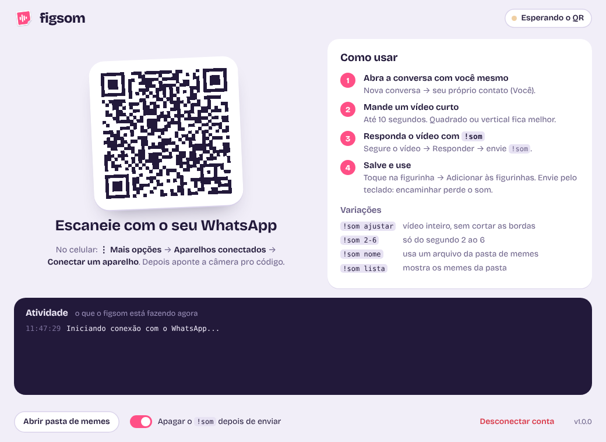
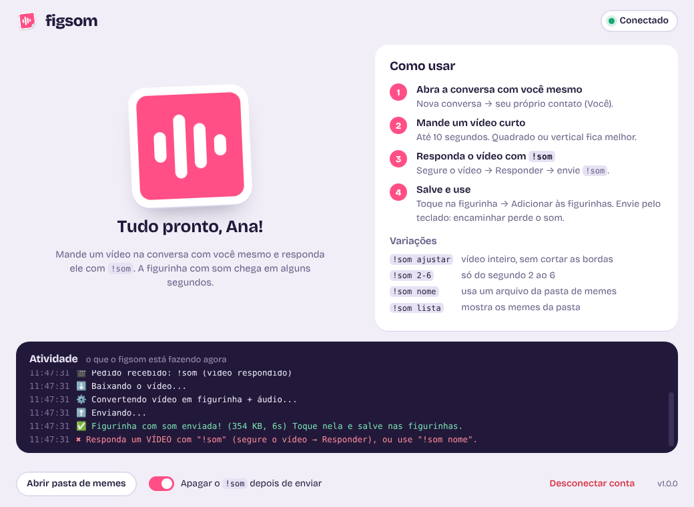

# Tutorial: como usar o figsom

Guia pra quem só quer baixar e usar: não precisa instalar Node.js, ffmpeg nem abrir terminal. Leva uns 5 minutos.

> Prefere rodar pelo terminal? Veja o [modo terminal no Windows](TERMINAL.md) ou [no Linux](LINUX.md).

> [!WARNING]
> O figsom é **não oficial** e se conecta ao seu WhatsApp como um aparelho vinculado. Isso viola os termos do WhatsApp e **pode causar banimento**. O risco é baixo pra uso pessoal, mas existe. Se puder, use um número secundário.

---

## Parte 1: Instalar

### Windows

1. Abra a página de **[Releases](https://github.com/winipassaia/figsom/releases/latest)**.
2. Baixe o **`figsom-…-instalador-windows.exe`**.
3. Abra o arquivo. Se aparecer **"O Windows protegeu o computador"**, clique em **Mais informações** e depois em **Executar assim mesmo**.
   > O aviso aparece porque o figsom não tem assinatura digital, um certificado pago. O código está todo aberto no GitHub.
4. Siga o instalador. No fim, o figsom abre sozinho e ganha um atalho no menu Iniciar.

> Não quer instalar? Baixe o **`figsom-…-portatil-windows.exe`** e abra direto. Ele demora alguns segundos a mais pra abrir.

### Linux

1. Na página de **[Releases](https://github.com/winipassaia/figsom/releases/latest)**, baixe o **`figsom-…-linux.AppImage`**.
2. Dê permissão de execução: botão direito → Propriedades → Permissões → "Permitir executar como programa", ou no terminal:
   ```bash
   chmod +x figsom-*-linux.AppImage
   ```
3. Abra com dois cliques.

> Em algumas distros o AppImage pede o pacote `libfuse2`: `sudo apt install libfuse2`.

---

## Parte 2: Conectar no WhatsApp



1. Na primeira vez, o figsom mostra um **aviso** explicando os riscos. Leia e clique em **Entendi, quero continuar**.
2. Aparece um **QR code**.
3. No celular, abra o WhatsApp, toque em **⋮ (Mais opções)**, depois em **Aparelhos conectados** e em **Conectar um aparelho**.
4. Aponte a câmera pro QR na tela do computador.

Quando conectar, aparece **"Tudo pronto!"** e o selo no canto fica verde: **Conectado**.

Nas próximas vezes, é só abrir o figsom, que ele conecta sozinho, sem QR.

---

## Parte 3: Criar figurinhas com som



### 1. Abra a conversa com você mesmo

No WhatsApp, toque em **Nova conversa** e escolha **o seu próprio contato**, que aparece como **"(Você)"** ou **"Mensagem para você"**.

O figsom **só obedece comandos nessa conversa**.

### 2. Mande um vídeo e responda com `!som`

1. Envie um vídeo curto nessa conversa. O figsom usa no máximo **10 segundos**.
2. **Segure o dedo no vídeo** e toque em **Responder**.
3. Escreva `!som` e envie.

No figsom, o quadro **Atividade** mostra cada etapa: baixando, convertendo, enviando. Em alguns segundos a **figurinha com som** chega na conversa, com um ícone de áudio.

### 3. Salve e use

1. Toque na figurinha.
2. Toque em **Adicionar às figurinhas** (ou na ⭐).
3. Pronto: ela fica no seu **teclado de figurinhas** pra mandar em qualquer conversa.

> [!IMPORTANT]
> **Não encaminhe a figurinha**, porque encaminhar perde o som. Mande sempre pelo teclado de figurinhas.

### Variações do `!som`

| Comando | Resultado |
|---|---|
| `!som` | Figurinha **quadrada**, cortando o **centro** do vídeo (padrão) |
| `!som ajustar` | Vídeo **inteiro** dentro do quadrado, com bordas transparentes |
| `!som 2-6` | Usa só do segundo **2** ao **6** |
| `!som 1,5-4 ajustar` | Dá pra combinar |

### Pasta de memes

O botão **Abrir pasta de memes** abre `Documentos/figsom/memes`. Coloque arquivos lá e use pelo nome, sem precisar mandar o vídeo pelo WhatsApp:

| Arquivos na pasta | Comando |
|---|---|
| `tome.mp4` | `!som tome` |
| `gato.gif` + `gato.mp3` | `!som gato` (GIF com o som do mp3) |
| `pronta.webp` + `pronta.ogg` | `!som pronta` |

As variações também funcionam aqui: `!som tome 3-7 ajustar`. `!som lista` manda a lista dos memes da pasta.

### Desligar e desconectar

- **Fechar a janela** desliga o figsom. Ele não fica rodando escondido.
- **Desconectar conta**, no canto de baixo, remove o figsom dos aparelhos conectados e apaga a sessão do computador.

---

## Problemas comuns

| Problema | Solução |
|---|---|
| "O Windows protegeu o computador" | **Mais informações** → **Executar assim mesmo**. |
| O QR não aparece e fica em "Conectando…" | Confira sua internet. A Atividade mostra se ele está tentando de novo. |
| `!som` não faz nada | Confira se está na conversa **"Você"** e se **respondeu** o vídeo (segurar → Responder). |
| A figurinha chegou sem som | Ela foi encaminhada. Mande pelo teclado de figurinhas. |
| A figurinha cortou uma parte importante | Use `!som ajustar`. |
| Desconectei pelo celular | Abra o figsom de novo e escaneie o novo QR. |
| AppImage não abre no Linux | `chmod +x` no arquivo e, se pedir, `sudo apt install libfuse2`. |

## Onde ficam os dados

| | Windows | Linux |
|---|---|---|
| Sessão do WhatsApp | `%APPDATA%\figsom\auth` | `~/.config/figsom/auth` |
| Pasta de memes | `Documentos\figsom\memes` | `~/Documentos/figsom/memes` (ou `~/Documents`) |

> [!CAUTION]
> A pasta `auth` dá acesso total ao seu WhatsApp. Nunca compartilhe. Pra apagar, use **Desconectar conta**.
